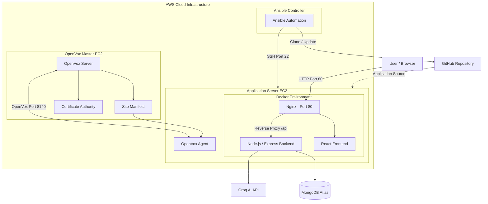
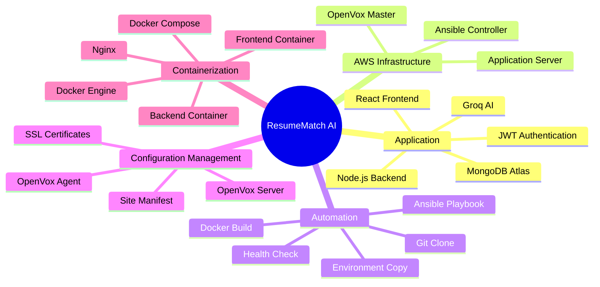
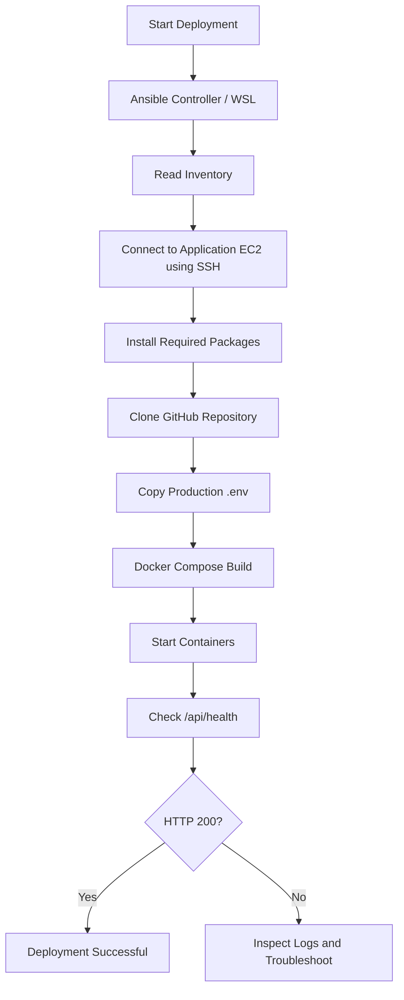

# ResumeMatch AI – Automated Deployment using Ansible, OpenVox & Docker

ResumeMatch AI is a full-stack MERN application that helps users evaluate resumes using AI-powered feedback, compare resumes against job descriptions, and manage chat-based analysis sessions.

This project extends the application with an automated cloud deployment and configuration management infrastructure using **AWS EC2, Ansible, OpenVox (Puppet-compatible), Docker, and Docker Compose**.

The deployment infrastructure uses three EC2 instances to separate orchestration, configuration management, and application hosting.

---

# Table of Contents

1. [Project Overview](#1-project-overview)
2. [Key Features](#2-key-features)
3. [Technology Stack](#3-technology-stack)
4. [System Architecture](#4-system-architecture)
5. [Architecture Diagram](#5-architecture-diagram)
6. [Infrastructure Mind Map](#6-infrastructure-mind-map)
7. [Deployment Workflow Mind Map](#7-deployment-workflow-mind-map)
8. [AWS Infrastructure](#8-aws-infrastructure)
9. [Project Directory Structure](#9-project-directory-structure)
10. [Prerequisites](#10-prerequisites)
11. [Environment Configuration](#11-environment-configuration)
12. [Local Application Setup](#12-local-application-setup)
13. [OpenVox Configuration](#13-openvox-configuration)
14. [Ansible Configuration](#14-ansible-configuration)
15. [Docker Configuration](#15-docker-configuration)
16. [Application Deployment](#16-application-deployment)
17. [Accessing the Application](#17-accessing-the-application)
18. [Verification Commands](#18-verification-commands)
19. [API Documentation](#19-api-documentation)
20. [Troubleshooting](#20-troubleshooting)
21. [Security Considerations](#21-security-considerations)

---

# 1. Project Overview

ResumeMatch AI combines an AI-powered resume analysis application with an automated infrastructure deployment pipeline.

The application is built using the MERN stack and integrates the Groq API for AI-powered resume analysis.

The infrastructure automates application deployment through Ansible while OpenVox manages the configuration of the application server.

### Main Objectives

- Develop a full-stack AI-powered resume analysis platform.
- Host the application on AWS EC2.
- Automate application deployment using Ansible.
- Manage server configurations using OpenVox.
- Containerize frontend and backend services using Docker.
- Use Docker Compose to manage application containers.
- Maintain separation between orchestration, configuration management, and application hosting.

# 2. Key Features

## Application Features

### Authentication and Session Management
- User registration and login.
- JWT-based authentication.
- Protected application routes.
- User profile management.
- Password recovery and password change functionality.

### AI Resume Analysis
- Upload PDF resumes for analysis.
- Optional job description-based matching.
- AI-generated strengths and weaknesses.
- Resume improvement suggestions.
- Readiness assessment and recommended next steps.

### Chat Management
- Create new analysis chats.
- View chat history.
- Rename and delete conversations.
- Continue previous AI conversations.
- Manage file attachments.

### User Interface
- React-based dashboard.
- Dark theme.
- Responsive interface.
- Landing page.
- Custom 404 page.

## DevOps Features

- Three-instance AWS EC2 infrastructure.
- Ansible-based deployment automation.
- OpenVox-based configuration management.
- Docker containerization.
- Docker Compose orchestration.
- Automated health-check verification.
- Git-based application deployment.

# 3. Technology Stack

| Category | Technologies |
|---|---|
| Frontend | React, React Router, Tailwind CSS, Axios |
| Backend | Node.js, Express.js |
| Database | MongoDB Atlas, Mongoose |
| AI Integration | Groq SDK |
| Authentication | JWT, HTTP-only Cookies |
| Cloud Infrastructure | AWS EC2 |
| Configuration Management | OpenVox Server and Agent |
| Automation | Ansible |
| Containerization | Docker |
| Container Orchestration | Docker Compose |
| Web Server | Nginx |
| Version Control | Git and GitHub |
| Operating System | Ubuntu 24.04 LTS |

# 4. System Architecture

The infrastructure is divided into three major components.

### 1. Ansible Controller

Responsible for:
- Executing Ansible playbooks.
- Connecting to the application server through SSH.
- Cloning or updating the GitHub repository.
- Copying production environment configuration.
- Building and starting Docker containers.
- Performing application health checks.

Ansible is currently executed from the local WSL Ubuntu environment. A separate Ansible Controller EC2 instance is also provisioned in the infrastructure.

### 2. OpenVox Master Server

Responsible for:
- Managing configuration of connected agents.
- Maintaining node manifests.
- Distributing configuration catalogs.
- Managing SSL certificates.
- Ensuring required packages and services are installed.

### 3. Application Server

Responsible for:
- Running the ResumeMatch AI application.
- Running Docker and Docker Compose.
- Running frontend and backend containers.
- Connecting to MongoDB Atlas.
- Communicating with the OpenVox Master.

# 5. Architecture Diagram

The following diagram illustrates the overall infrastructure and communication between components.



### Communication Ports

| Port | Service | Purpose |
|---|---|---|
| 22 | SSH | Secure server administration and Ansible connectivity |
| 80 | HTTP | Public application access |
| 8140 | OpenVox | Master-Agent communication |
| 5000 | Express | Internal backend service |

Port 5000 is not exposed publicly. The backend is accessed through Nginx reverse proxy.

# 6. Infrastructure Mind Map



# 7. Deployment Workflow Mind Map



# 8. AWS Infrastructure

The project uses three EC2 instances in the AWS US East (N. Virginia) region.

**Region:** `us-east-1`

**Operating System:** Ubuntu 24.04 LTS

| Instance | Responsibility | Instance Type |
|---|---|---|
| Ansible Controller | Automation and orchestration | EC2 |
| OpenVox Master | Configuration management | t3.small |
| Application Server | Dockerized MERN application | t3.small |

### Network Configuration

- All three instances belong to the same VPC.
- SSH access is configured through security groups.
- Ansible connects to the application server using SSH.
- OpenVox Agent communicates with the Master on TCP port 8140.
- HTTP access is provided through TCP port 80.
- Backend port 5000 remains internal.

### Security Group Rules

| Instance | Port | Source |
|---|---:|---|
| Application Server | 80 | `0.0.0.0/0` |
| Application Server | 22 | Controller Security Group / Admin IP |
| OpenVox Master | 22 | Controller Security Group / Admin IP |
| OpenVox Master | 8140 | Application Server Security Group |

Never expose the OpenVox port to the entire internet.

# 9. Project Directory Structure

```text
Resume-Matcher-AI-Ansible/
│
├── client/
│   ├── public/
│   ├── src/
│   ├── Dockerfile
│   └── package.json
│
├── server/
│   ├── config/
│   ├── controllers/
│   ├── middleware/
│   ├── models/
│   ├── routes/
│   ├── services/
│   ├── Dockerfile
│   ├── app.js
│   ├── package.json
│   └── .env
│
├── inventory.ini
├── deploy.yml
├── docker-compose.yml
├── README.md
└── .gitignore
```

Note: `server/.env` is a local production configuration file and is excluded from Git.

# 10. Prerequisites

Before deploying the project, ensure the following are available:

### Local Machine
- Windows 11 or Linux.
- WSL Ubuntu.
- Python 3.
- Ansible.
- OpenSSH client.
- Git.
- AWS account.
- EC2 SSH private key.

### AWS Infrastructure
- Three EC2 instances.
- Appropriate security groups.
- Ubuntu 24.04 LTS.
- SSH access to the application server and OpenVox Master.

### External Services
- MongoDB Atlas account and connection URI.
- Groq API key.
- SMTP credentials if email features are required.

# 11. Environment Configuration

Create the backend environment file:

```bash
cd server
nano .env
```

Configure the required variables.

| Variable | Description |
|---|---|
| `MONGODB_URI` | MongoDB Atlas connection string |
| `JWT_SECRET` | JWT signing secret |
| `JWT_EXPIRE` | JWT expiration |
| `JWT_COOKIE_EXPIRE` | Cookie expiration |
| `PORT` | Backend port |
| `NODE_ENV` | Application environment |
| `CLIENT_URL` | Frontend URL |
| `GROQ_API_KEY` | Groq API key |
| `GROQ_MODEL` | Groq model |
| `EMAIL_SERVICE` | Email service |
| `EMAIL_HOST` | SMTP hostname |
| `EMAIL_PORT` | SMTP port |
| `EMAIL_USER` | SMTP username |
| `EMAIL_PASSWORD` | SMTP password |
| `EMAIL_FROM` | Sender email address |

Additional optional variables:

```env
MAX_RESUME_FILE_SIZE_BYTES=
MAX_RESUME_TEXT_CHARS=
MAX_JOB_DESCRIPTION_CHARS=
MAX_CHAT_MESSAGE_CHARS=
```

### Cookie Configuration

For the current HTTP testing environment:

```env
COOKIE_SECURE=false
COOKIE_SAME_SITE=lax
```

These settings are for HTTP testing only. A real production deployment should use HTTPS and secure cookie settings.

**Important:** Never commit `.env` files or actual API keys to GitHub.

# 12. Local Application Setup

Clone the repository:

```bash
git clone https://github.com/Ashutosh-kumar-2004/Resume-Matcher-AI-Ansible.git
```

Move into the project:

```bash
cd Resume-Matcher-AI-Ansible
```

Install backend dependencies:

```bash
cd server
npm install
```

Install frontend dependencies:

```bash
cd ../client
npm install
```

### Run Backend

Open a terminal:

```bash
cd server
npm run dev
```

Backend default address:

```text
http://localhost:5000
```

### Run Frontend

Open another terminal:

```bash
cd client
npm run dev
```

Frontend default address:

```text
http://localhost:5173
```

# 13. OpenVox Configuration

OpenVox is used for configuration management between the Master and Application Server.

### OpenVox Components

- OpenVox Server: Central configuration management server.
- OpenVox Agent: Installed on the application server.
- Certificate Authority: Manages agent authentication certificates.
- Site Manifest: Defines the desired state of the application server.

### Step 1: Configure the Agent

On the Application Server:

```bash
sudo /opt/puppetlabs/bin/puppet config set server ip-172-31-26-24.ec2.internal --section main
```

Verify the configured server:

```bash
sudo /opt/puppetlabs/bin/puppet config print server --section main
```

### Step 2: Request Agent Certificate

On the Application Server:

```bash
sudo /opt/puppetlabs/bin/puppet agent --test
```

This creates a certificate signing request.

### Step 3: Sign Certificate

On the OpenVox Master:

```bash
sudo /opt/puppetlabs/bin/puppetserver ca list --all
```

Sign the Application Server certificate:

```bash
sudo /opt/puppetlabs/bin/puppetserver ca sign --certname ip-172-31-25-164.ec2.internal
```

### Step 4: Create the Site Manifest

On the OpenVox Master:

```bash
sudo nano /etc/puppetlabs/code/environments/production/manifests/site.pp
```

Example manifest:

```puppet
node 'ip-172-31-25-164.ec2.internal' {

  package { ['docker.io', 'docker-compose-v2', 'git']:
    ensure => installed,
  }

  service { 'docker':
    ensure  => running,
    enable  => true,
    require => Package['docker.io'],
  }

  user { 'ubuntu':
    groups     => ['docker'],
    membership => minimum,
    require    => Package['docker.io'],
  }

}
```

Validate manifest syntax:

```bash
sudo /opt/puppetlabs/bin/puppet parser validate /etc/puppetlabs/code/environments/production/manifests/site.pp
```

### Step 5: Apply Configuration

On the Application Server:

```bash
sudo /opt/puppetlabs/bin/puppet agent --test
```

Enable and start the agent service:

```bash
sudo systemctl enable puppet
sudo systemctl start puppet
```

Check agent status:

```bash
sudo systemctl status puppet --no-pager
```

Verify Docker installation:

```bash
docker --version
docker compose version
sudo systemctl is-active docker
```

Test Docker:

```bash
sudo docker run --rm hello-world
```

### OpenVox Master Service Verification

On the Master:

```bash
sudo systemctl status puppetserver --no-pager
```

Check port 8140:

```bash
sudo ss -tlnp | grep 8140
```

Check Master health:

```bash
sudo /opt/puppetlabs/bin/puppetserver health
```

# 14. Ansible Configuration

Ansible automates application deployment on the EC2 Application Server.

### Step 1: Install Ansible

On WSL Ubuntu:

```bash
sudo apt update
sudo apt install ansible -y
```

Verify installation:

```bash
ansible --version
```

### Step 2: Configure Inventory

Open:

```bash
nano inventory.ini
```

Example:

```ini
[app_servers]
resume_server ansible_host=YOUR_APP_SERVER_PUBLIC_IP ansible_user=ubuntu ansible_ssh_private_key_file=/home/ashutosh/.ssh/resume-matcher-key.pem
```

Replace `YOUR_APP_SERVER_PUBLIC_IP` with the current public IP of the Application Server.

### Step 3: Test SSH Connectivity

```bash
ssh -i ~/.ssh/resume-matcher-key.pem ubuntu@YOUR_APP_SERVER_PUBLIC_IP
```

Return to the local terminal:

```bash
exit
```

### Step 4: Test Ansible Connectivity

```bash
ansible app_servers -i inventory.ini -m ping
```

Expected result:

```text
resume_server | SUCCESS => {
    "changed": false,
    "ping": "pong"
}
```

# 15. Docker Configuration

The project uses two Docker containers:

1. Frontend container – React application served through Nginx.
2. Backend container – Node.js and Express API.

### Docker Compose

The `docker-compose.yml` file manages both services.

```yaml
services:
  backend:
    build:
      context: ./server
      dockerfile: Dockerfile
    container_name: resume-matcher-backend
    restart: unless-stopped
    env_file:
      - ./server/.env
    environment:
      PORT: "5000"
      NODE_ENV: production
      CLIENT_URL: http://YOUR_APP_SERVER_PUBLIC_IP
    expose:
      - "5000"
    networks:
      - resume-network

  frontend:
    build:
      context: ./client
      dockerfile: Dockerfile
    container_name: resume-matcher-frontend
    restart: unless-stopped
    ports:
      - "80:80"
    depends_on:
      - backend
    networks:
      - resume-network

networks:
  resume-network:
    driver: bridge
```

Replace `YOUR_APP_SERVER_PUBLIC_IP` with the current application server public IP if configuring a new environment.

### Container Communication

```text
Browser
   |
   v
Nginx (Port 80)
   |
   +----> React Frontend
   |
   +----> /api requests
              |
              v
       Express Backend (5000)
              |
              +----> MongoDB Atlas
              |
              +----> Groq API
```

The backend port is exposed only inside the Docker network.

# 16. Application Deployment

This section describes the actual automated deployment workflow.

### Step 1: Move to Project Directory

On WSL Ubuntu:

```bash
cd ~/Resume-Matcher-AI-Ansible
```

### Step 2: Switch to Deployment Branch

```bash
git checkout feature/puppet-integration
```

### Step 3: Verify Repository Status

```bash
git status
```

### Step 4: Validate Ansible Playbook

```bash
ansible-playbook -i inventory.ini deploy.yml --syntax-check
```

### Step 5: Execute Deployment

```bash
ansible-playbook -i inventory.ini deploy.yml
```

### Ansible Deployment Tasks

The `deploy.yml` playbook performs the following operations:

1. Gather facts from the application server.
2. Install Git.
3. Create the application directory.
4. Clone or update the GitHub repository.
5. Copy the production environment file.
6. Build and start Docker containers.
7. Check the application health endpoint.

### Deployment Playbook

```yaml
---
- name: Deploy Resume Matcher AI on EC2
  hosts: app_servers
  become: true

  vars:
    app_dir: /home/ubuntu/resume-matcher-app

  tasks:
    - name: Install Git
      ansible.builtin.apt:
        name: git
        state: present
        update_cache: true

    - name: Ensure application directory exists
      ansible.builtin.file:
        path: "{{ app_dir }}"
        state: directory
        owner: ubuntu
        group: ubuntu
        mode: "0755"

    - name: Clone or update application repository
      become_user: ubuntu
      ansible.builtin.git:
        repo: https://github.com/Ashutosh-kumar-2004/Resume-Matcher-AI-Ansible.git
        dest: "{{ app_dir }}"
        version: feature/puppet-integration
        update: true

    - name: Copy production environment file
      ansible.builtin.copy:
        src: server/.env
        dest: "{{ app_dir }}/server/.env"
        owner: ubuntu
        group: ubuntu
        mode: "0600"

    - name: Build and start Docker containers
      become_user: ubuntu
      ansible.builtin.command:
        cmd: docker compose up -d --build
        chdir: "{{ app_dir }}"

    - name: Wait for application health endpoint
      ansible.builtin.uri:
        url: http://127.0.0.1/api/health
        method: GET
        status_code: 200
      register: health_check
      retries: 15
      delay: 10
      until: health_check.status == 200
```

### Expected Deployment Result

```text
PLAY RECAP

resume_server:
    ok=7
    changed=4
    unreachable=0
    failed=0
```

A successful HTTP 200 response from `/api/health` confirms that the application health check passed.

# 17. Accessing the Application

After successful deployment, open:

```text
http://YOUR_APP_SERVER_PUBLIC_IP
```

The application is served through Nginx on port 80.

### Application Testing

1. Open the landing page.
2. Register a new account or log in.
3. Open the dashboard.
4. Create a new chat.
5. Upload a PDF resume.
6. Submit a resume analysis request.
7. Verify AI-generated feedback.
8. Test chat history and profile functionality.

# 18. Verification Commands

### Ansible Controller / WSL

Check Ansible version:

```bash
ansible --version
```

Check connectivity:

```bash
ansible app_servers -i inventory.ini -m ping
```

Validate playbook:

```bash
ansible-playbook -i inventory.ini deploy.yml --syntax-check
```

Run deployment:

```bash
ansible-playbook -i inventory.ini deploy.yml
```

### Application Server

Connect using SSH:

```bash
ssh -i ~/.ssh/resume-matcher-key.pem ubuntu@YOUR_APP_SERVER_PUBLIC_IP
```

Check Docker:

```bash
docker --version
docker compose version
```

Check containers:

```bash
sudo docker ps
```

Check container logs:

```bash
sudo docker logs resume-matcher-backend
sudo docker logs resume-matcher-frontend
```

Check Docker service:

```bash
sudo systemctl status docker --no-pager
```

Check application health:

```bash
curl -i http://127.0.0.1/api/health
```

Check Nginx response:

```bash
curl -I http://127.0.0.1
```

### OpenVox Master

```bash
sudo systemctl status puppetserver --no-pager
```

```bash
sudo /opt/puppetlabs/bin/puppetserver ca list --all
```

### OpenVox Agent

```bash
sudo systemctl status puppet --no-pager
```

```bash
sudo /opt/puppetlabs/bin/puppet agent --test
```

# 19. API Documentation

Base URL (local):

```text
http://localhost:5000
```

### Health

| Method | Endpoint | Authentication |
|---|---|---|
| GET | `/api/health` | No |

### Authentication

| Method | Endpoint | Authentication |
|---|---|---|
| POST | `/api/auth/signup` | No |
| POST | `/api/auth/login` | No |
| POST | `/api/auth/logout` | No |
| GET | `/api/auth/me` | Yes |

### Password

| Method | Endpoint | Authentication |
|---|---|---|
| POST | `/api/password/forgot-password` | No |
| POST | `/api/password/reset-password/:token` | No |
| POST | `/api/password/validate-token/:token` | No |
| POST | `/api/password/change-password` | Yes |

### Profile

| Method | Endpoint | Authentication |
|---|---|---|
| GET | `/api/profile` | Yes |
| PUT | `/api/profile/update` | Yes |
| DELETE | `/api/profile/delete` | Yes |
| GET | `/api/profile/:userId` | No |

### Chats

| Method | Endpoint | Authentication |
|---|---|---|
| POST | `/api/chats` | Yes |
| GET | `/api/chats` | Yes |
| PATCH | `/api/chats/:chatId` | Yes |
| DELETE | `/api/chats/:chatId` | Yes |
| GET | `/api/chats/:chatId/messages` | Yes |
| POST | `/api/chats/:chatId/messages` | Yes |
| DELETE | `/api/chats/:chatId/messages/:messageId/files/:fileIndex` | Yes |
| GET | `/api/chats/:chatId/messages/:messageId/files/:fileIndex/open` | Yes |
| GET | `/api/chats/:chatId/messages/:messageId/files/:fileIndex/content` | Yes |

### Resume Analysis

| Method | Endpoint | Authentication |
|---|---|---|
| POST | `/api/resume/analyze` | Yes |

Content type:

```text
multipart/form-data
```

# 20. Troubleshooting

### 1. Ansible SSH Connection Failure

Check:
- Correct public IP in `inventory.ini`.
- Correct private key path.
- Private key permissions.
- SSH inbound security group rule.

Set key permissions:

```bash
chmod 400 ~/.ssh/resume-matcher-key.pem
```

### 2. Docker Command Not Found

Verify Docker installation:

```bash
docker --version
```

Check Docker service:

```bash
sudo systemctl status docker
```

If required, apply OpenVox configuration:

```bash
sudo /opt/puppetlabs/bin/puppet agent --test
```

### 3. Application Not Accessible

Check containers:

```bash
sudo docker ps
```

Check security group:
- HTTP port 80 must allow the intended client traffic.
- Backend port 5000 must not be exposed publicly.

Check logs:

```bash
sudo docker logs resume-matcher-backend
sudo docker logs resume-matcher-frontend
```

### 4. Application Health Check Failure

Run:

```bash
curl -i http://127.0.0.1/api/health
```

Check backend logs:

```bash
sudo docker logs resume-matcher-backend
```

### 5. Authentication Cookie Problems

Check:
- Cookie settings in backend environment.
- Browser cookie blocking messages.
- Frontend and backend origin configuration.
- HTTP versus HTTPS requirements.

For temporary HTTP testing:

```env
COOKIE_SECURE=false
COOKIE_SAME_SITE=lax
```

Do not use insecure cookie settings for a real production deployment.

### 6. AI Analysis Failure

Check:
- MongoDB Atlas connectivity.
- Groq API key.
- Groq model availability.
- Resume file size and PDF format.

# 21. Security Considerations

- Never commit `.env` files.
- Never expose API keys or database credentials.
- Use SSH keys for EC2 administration.
- Restrict SSH access using security groups.
- Restrict OpenVox port 8140 to trusted infrastructure.
- Do not expose backend port 5000 publicly.
- Use HTTP-only cookies for authentication.
- Use HTTPS and secure cookies for production deployments.
- Regularly review EC2 security group rules.
- Keep application dependencies and operating system packages updated.

---

# Deployment Summary

| Component | Responsibility | Status |
|---|---|---|
| AWS EC2 | Cloud infrastructure | Configured |
| Ansible | Deployment automation | Working |
| OpenVox | Configuration management | Working |
| Docker | Application containerization | Working |
| Docker Compose | Frontend/backend orchestration | Working |
| Nginx | Frontend serving and API reverse proxy | Configured |
| MongoDB Atlas | Database | External service |
| Groq API | AI resume analysis | Integrated |
| Health Check | Deployment verification | Passed |
| Authentication | JWT and cookie-based login | Tested |

## Final Deployment Flow

```text
GitHub Repository
       |
       v
Ansible Automation
       |
       v
Application EC2
       |
       v
OpenVox Configuration
       |
       v
Docker Installation
       |
       v
Docker Compose Build
       |
       v
Frontend + Backend Containers
       |
       v
Nginx Reverse Proxy
       |
       v
ResumeMatch AI Application
```

**Project:** ResumeMatch AI

**Repository:** https://github.com/Ashutosh-kumar-2004/Resume-Matcher-AI-Ansible

**Deployment Branch:** `feature/puppet-integration`

**Infrastructure:** AWS EC2

**Automation:** Ansible + OpenVox

**Containerization:** Docker + Docker Compose
